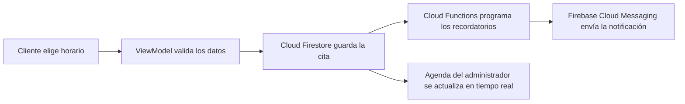

# Diseño de la aplicación CitaFácil

**Módulo 4 | Desarrollo de Aplicaciones Android**

Esta página documenta cómo se aplican los conceptos de diseño de aplicaciones, diseño conversacional e infraestructura digital al proyecto CitaFácil. Complementa la página de [Wireframes](Wireframes) del módulo 3.

---

## 1. Proceso de diseño aplicado a CitaFácil

La guía de Mobivery describe el trabajo del diseñador UX/UI en diez pasos (Abajo, 2018). Esta tabla muestra cómo se aplica cada paso al proyecto.

| Paso | Qué propone la guía | Aplicación en CitaFácil | Estado |
|---|---|---|---|
| 1. Recopilar información | Briefing, presupuesto, ideas del cliente e identidad de marca | Problema empresarial definido en el módulo 1: interrupciones, ausentismo y falta de datos | Completado |
| 2. Buscar referencias | Analizar apps similares y crear un *mood board* | Revisión de apps de reservas pensadas para cadenas y de su costo para negocios pequeños | Completado |
| 3. Mapa de navegación | Esquema de toda la navegación, primero en papel y luego en digital | Boceto en papel y wireframe en Figma con 9 pantallas | Completado |
| 4. Validar con el equipo | Confirmar que todo sea factible y usable | Revisión del wireframe: se corrigieron botones sin pantalla y la mezcla de perfiles | Completado |
| 5. Validar con el cliente | Aprobar la navegación antes de diseñar la interfaz | Validación con dueños de barberías | Pendiente |
| 6. Probar la línea gráfica | Dos o tres pantallas modelo con el estilo visual | Pantallas de Inicio, Horario y Agenda con Material Design 3 | Pendiente |
| 7. Aplicar la UI | Llevar el estilo al resto de pantallas | Aplicar el estilo aprobado a las 9 pantallas | Pendiente |
| 8. Traspasar a desarrollo | Prototipo y especificaciones exactas | Prototipo navegable en Figma y especificaciones para Jetpack Compose | Pendiente |
| 9. Probar la app | Revisar cada vista contra el diseño acordado | Pruebas con usuarios reales de ambos perfiles | Pendiente |
| 10. Publicar | Íconos, capturas y recursos para la tienda | Recursos visuales para Google Play | Pendiente |

### Herramientas por etapa

| Etapa | Herramienta | Uso en el proyecto |
|---|---|---|
| Esquema inicial | Papel y lápiz | Boceto del flujo completo |
| Wireframe digital | Figma | Nueve pantallas en escala de grises |
| Prototipado | Figma (modo Prototype); la guía también menciona InVision, Proto.io y Marvel | Simular la navegación antes de programar |
| Traspaso a desarrollo | Figma (modo Dev); la guía menciona Zeplin | Medidas, colores y fuentes exactas |
| Plataformas sin código | Andromo y similares | Descartadas: CitaFácil necesita lógica propia de reservas, roles y sincronización |

---

## 2. Quién, qué, cuándo, dónde, cómo y por qué

| Pregunta | Respuesta en CitaFácil |
|---|---|
| **¿Quién?** | El desarrollador (que cumple también el rol de diseñador), los dueños de negocios que validan y los usuarios finales: clientes y administradores |
| **¿Qué?** | La experiencia (flujo, navegación y lógica) y la interfaz (componentes, colores y tipografía) |
| **¿Cuándo?** | Antes de programar, durante el desarrollo y después del lanzamiento, de forma iterativa |
| **¿Dónde?** | En papel, en Figma, en el dispositivo real y en canales más allá de la pantalla, como las notificaciones |
| **¿Cómo?** | Investigar, esquematizar, validar, diseñar, prototipar, traspasar y probar |
| **¿Por qué?** | Si reservar resulta confuso, el cliente vuelve a llamar por teléfono y el problema del negocio sigue sin resolverse |

---

## 3. Diseño conversacional

El diseño conversacional es un lenguaje de diseño basado en la conversación humana: cuanto más se apoya una interfaz en la forma natural en que nos comunicamos, menos hay que enseñar a usarla (Google, 2024). Aunque CitaFácil es una app de pantalla, muchas de sus interacciones son conversaciones: un recordatorio, una confirmación o un mensaje de error.

> **Nota:** Google dejó de dar soporte a las Conversational Actions de Asistente en junio de 2023. Los principios de diseño conversacional siguen siendo válidos para notificaciones, chatbots y asistentes de voz, y así se aplican aquí.

### 3.1 Persona del sistema

La persona del sistema garantiza que todos los mensajes de la app suenen igual, sin importar quién los escriba.

**CitaFácil es:** amable, breve, confiable y práctica.

**CitaFácil no es:** formal en exceso, graciosa a costa del usuario ni técnica.

| Situación | Así sí | Así no |
|---|---|---|
| Recordatorio | "Tu corte es mañana a las 10:00 con Carlos." | "Se le notifica que tiene una cita programada para el día de mañana." |
| Error | "Ese horario acaba de ocuparse. Estos siguen libres:" | "Error 409: conflicto de recurso." |
| Confirmación | "¡Listo! Te esperamos el jueves a las 10:00." | "Operación completada exitosamente." |

### 3.2 Personas de usuario

**Carlos, 35 años — administrador.** Es dueño de una barbería con un solo empleado. Revisa la agenda con una mano entre cliente y cliente y no tiene tiempo para leer textos largos.
- **Meta:** saber quién sigue y detectar huecos en la agenda.
- **Contexto:** de pie, con las manos ocupadas, con ruido de fondo.
- **Implicación de diseño:** agenda visible al abrir la app, estados con una sola letra y un botón "+" al alcance del pulgar.

**Ana, 28 años — clienta.** Trabaja en una oficina y reserva desde el autobús camino al trabajo.
- **Meta:** reservar un corte para el sábado sin llamar.
- **Contexto:** conexión intermitente y pocos minutos disponibles.
- **Implicación de diseño:** reserva en tres pasos, consulta de citas sin conexión y recordatorios con acciones directas.

### 3.3 Diálogos de ejemplo

**Recordatorio con confirmación**

> **CitaFácil:** Hola, Ana. Tu corte es mañana a las 10:00 con Carlos. ¿Confirmas?
>
> *[Confirmar]* *[Reprogramar]* *[Cancelar]*
>
> **Ana:** *(toca Confirmar)*
>
> **CitaFácil:** ¡Perfecto! Te esperamos mañana.

**Horario ocupado durante la reserva**

> **Ana:** *(elige el jueves a las 10:00)*
>
> **CitaFácil:** Ese horario acaba de ocuparse. Estos siguen libres el jueves:
>
> *[10:30]* *[11:30]* *[12:00]*

**Cancelación**

> **Ana:** *(toca Cancelar)*
>
> **CitaFácil:** ¿Quieres cancelar tu corte del jueves a las 10:00?
>
> *[Sí, cancelar]* *[No, mantener]*
>
> **Ana:** *(toca Sí, cancelar)*
>
> **CitaFácil:** Tu cita fue cancelada. Gracias por avisar: así otro cliente puede usar ese horario.

**Aviso al administrador**

> **CitaFácil:** Ana canceló su corte del jueves a las 10:00. El horario ya está disponible para nuevas reservas.

### 3.4 Componentes conversacionales aplicados

| Componente | Uso en CitaFácil |
|---|---|
| Saludos | Nombre del usuario al inicio de cada notificación |
| Preguntas | "¿Confirmas?" en los recordatorios |
| Confirmaciones | Resumen antes de reservar o cancelar |
| Sugerencias (chips) | Botones de acción directa: Confirmar, Reprogramar, Cancelar |
| Errores | Explicación simple más alternativas, nunca códigos técnicos |
| Disculpas | Solo cuando el fallo es de la app, por ejemplo, una caída del servicio |
| Cierres | Mensaje breve que confirma el resultado de la acción |

### 3.5 Guía de estilo del lenguaje

- Tutear al usuario y usar frases cortas.
- Poner primero la información más importante: qué, cuándo y con quién.
- Escribir fechas y horas siempre en el mismo formato: "jueves 24 sep, 10:00".
- No usar jerga técnica ni códigos de error.
- Ofrecer siempre una salida o alternativa después de un error.

---

## 4. El codelab de Interactive Canvas aplicado al proyecto

El codelab de Google construye *Snow Pal*, un juego que se controla por voz o por toque dentro de Asistente de Google. Su arquitectura tiene tres partes: una aplicación web con la interfaz, una acción de conversación que interpreta la entrada del usuario y un webhook con la lógica del juego desplegado en Cloud Functions (Google, s. f.-a).

### Comparación de arquitecturas

| Snow Pal (codelab) | CitaFácil |
|---|---|
| Aplicación web (HTML, CSS y JavaScript) | App Android con Jetpack Compose |
| Acción de conversación que reconoce la entrada | Interfaz que recibe los toques (y, en el futuro, la voz) |
| Webhook con la lógica del juego | Cloud Functions con la lógica de reservas y recordatorios |
| Estado compartido entre la app y el webhook | Estado de la agenda sincronizado en Cloud Firestore |
| Firebase Hosting para la app web | Google Play para distribuir la app |

### Flujo de una reserva en CitaFácil

### Lecciones del codelab para CitaFácil

1. **Separar la lógica de la interfaz.** En el codelab, el botón "volver a jugar" y la frase dicha en voz alta llegan a la misma lógica. En CitaFácil, la arquitectura MVVM separa la lógica de reservas de las pantallas, de modo que podría agregarse una reserva por voz sin reescribir el negocio.
2. **Mantener un estado único y compartido.** El codelab comparte el estado del juego entre la app y el webhook. CitaFácil usa Firestore como fuente única de verdad para la agenda, lo que evita las dobles reservas.
3. **Diseñar la interacción multimodal desde el inicio.** La voz no se agrega al final: la lógica debe estar preparada desde el principio para recibir distintos tipos de entrada.

---

## 5. Infraestructura digital y decisiones de diseño

Hu (2014) plantea tres maneras de construir una mejor infraestructura digital: políticas que incentiven la inversión, reducción de los costos de las redes y colaboración entre industrias para crear estándares comunes, incluidos los de la nube.

| Idea del artículo | Decisión de diseño en CitaFácil |
|---|---|
| La conectividad no es igual para todos | Consulta de citas sin conexión con Room y sincronización diferida con WorkManager |
| El acceso inalámbrico es la vía principal de conexión | Diseño para uso móvil, con pantallas ligeras y pocas imágenes pesadas |
| Los estándares comunes en la nube reducen costos | Firebase permite a un desarrollador individual ofrecer sincronización en tiempo real sin administrar servidores |

---

## Referencias

Abajo, L. (2018, 9 de marzo). *Piensa como un diseñador UX/UI: Super guía para el diseño de aplicaciones*. Mobivery. https://mobivery.com/super-guia-para-el-diseno-de-apps/

Andromo. (s. f.). *Andromo: Creador de aplicaciones móviles para Android e iOS*. Recuperado el 22 de septiembre de 2026, de https://www.andromo.com/es/

Google. (s. f.-a). *Cómo crear una acción de Interactive Canvas para Asistente de Google con Actions Builder*. Google Codelabs. Recuperado el 22 de septiembre de 2026, de https://codelabs.developers.google.com/codelabs/builder-canvas?hl=es-419

Google. (s. f.-b). *Conversation design: Welcome*. Google for Developers. Recuperado el 22 de septiembre de 2026, de https://developers.google.com/assistant/conversation-design/welcome?hl=es-419

Google. (2024). *What is conversation design?* Google for Developers. https://developers.google.com/assistant/conversation-design/what-is-conversation-design?hl=es-419

Hu, K. (2014, 1 de mayo). *Tres maneras de construir una mejor infraestructura digital*. Foro Económico Mundial. https://es.weforum.org/agenda/2014/05/tres-maneras-de-construir-una-mejor-infraestructura-digital/
