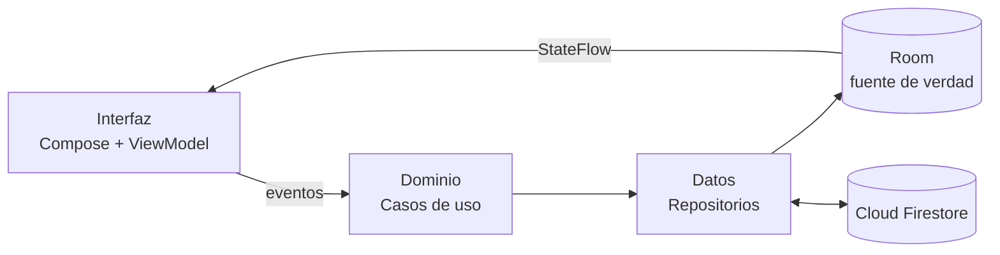
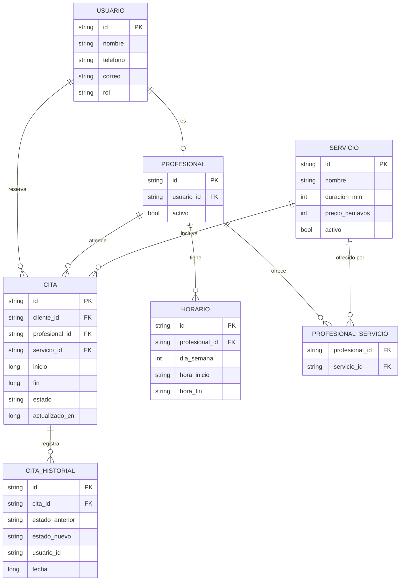

# CitaFácil — Gestión de citas y recordatorios

   

Aplicación nativa para Android que permite a barberías, salones de belleza y clínicas ambulatorias pequeñas digitalizar su agenda. El cliente reserva sin llamar por teléfono y recibe recordatorios automáticos; el administrador gestiona horarios, servicios y personal, y consulta indicadores de ocupación y ausentismo.

> **Curso:** Desarrollo de Aplicaciones Android · **Autor:** Carlos · **Entrega actual:** Módulo 5, progreso de la aplicación (versión 0.3.0, 18 de octubre de 2026)

## Contenido

1. [Problema](#problema)
2. [Plataforma y tecnologías](#plataforma-y-tecnologías)
3. [Funcionalidad](#funcionalidad)
4. [Arquitectura](#arquitectura)
5. [Diseño de la base de datos](#diseño-de-la-base-de-datos)
6. [Wireframes](#wireframes)
7. [Cronograma](#cronograma)
8. [Registro de cambios](#registro-de-cambios)
9. [Cómo ejecutar el proyecto](#cómo-ejecutar-el-proyecto)
10. [Referencias](#referencias)

## Problema

Los negocios de servicios por cita pierden ingresos por tres causas:

- **Tiempo administrativo:** reservar por teléfono interrumpe el servicio en curso, y la agenda en papel no evita la doble reserva.
- **Ausentismo sin aviso:** cada hora vacía es una pérdida irrecuperable. Los recordatorios automatizados reducen de forma significativa la inasistencia (McLean et al., 2016).
- **Falta de datos:** sin registros digitales, las decisiones sobre horarios, personal o promociones se toman por intuición.

## Plataforma y tecnologías

Nivel de API objetivo **37 (Android 17)**; nivel mínimo **26 (Android 8.0)**.

| Capa | Tecnología | Función |
|---|---|---|
| Interfaz | Jetpack Compose, Material 3 | Pantallas declarativas |
| Arquitectura | MVVM, ViewModel, StateFlow | Separación de lógica y presentación |
| Persistencia local | Room | Fuente única de verdad y uso sin conexión |
| Backend en la nube | Cloud Firestore | Sincronización de la agenda en tiempo real |
| Autenticación | Firebase Authentication | Registro por teléfono y correo |
| Notificaciones | Firebase Cloud Messaging, WorkManager | Recordatorios programados |
| Construcción | Gradle | Dependencias y compilación |
| Control de versiones | Git y GitHub | Historial, ramas e integración continua |

## Funcionalidad

**Cliente:** registro, selección de servicio, profesional, fecha y hora; confirmación; historial; cancelación o reprogramación; recordatorios a 24 h y 2 h.

**Administrador:** agenda diaria con estados por color, registro manual de citas, catálogo de servicios, horarios y bloqueos, gestión del personal, indicadores y avisos puntuales.

<details>
<summary>Requisitos funcionales y no funcionales</summary>

1. Registro y autenticación con roles de cliente y administrador.
2. Mostrar solo horarios disponibles según la duración del servicio y la agenda del profesional.
3. Impedir la doble reserva mediante una transacción atómica.
4. Enviar recordatorios automáticos antes de la cita.
5. Cancelar y reprogramar dentro de una ventana configurable.
6. Conservar el historial de citas de cada cliente.
7. CRUD de servicios, horarios y personal para el administrador.
8. Indicadores de ocupación, ingresos y ausentismo por período.
9. Consulta de las citas próximas sin conexión.

**No funcionales:** respuesta en menos de 2 s; reserva en 4 pasos como máximo; accesibilidad según Material Design; datos cifrados en tránsito y reglas de seguridad en Firestore; arquitectura por capas con pruebas unitarias.
</details>

## Arquitectura

Se siguen los principios de la guía oficial de Google: separación de responsabilidades, interfaz controlada por modelos de datos, fuente única de verdad y flujo de datos unidireccional (Google, 2026c).



| Capa | Componentes | Responsabilidad |
|---|---|---|
| Interfaz | `InicioScreen`, `ReservaScreen`, `AgendaAdminScreen` y sus ViewModel | Mostrar el estado y enviar eventos |
| Dominio | `ObtenerHorariosDisponibles`, `ReservarCita`, `CalcularIndicadores` | Reglas de negocio |
| Datos | `CitaRepository`, `ServicioRepository`, DAO de Room, cliente de Firestore | Persistencia y sincronización |

Las pantallas leen **solo** de Room; un proceso de sincronización escribe en Room los cambios que llegan de Firestore. Así la app funciona sin conexión y muestra siempre datos coherentes.

## Diseño de la base de datos

Modelo normalizado a tercera forma normal (Codd, 1970; Elmasri y Navathe, 2016).



**Decisiones de diseño**

- Precios como enteros en centavos para evitar errores de redondeo.
- Fechas en milisegundos UTC; la conversión a hora local ocurre solo en la interfaz.
- Borrado lógico (`activo`) de servicios y profesionales para conservar la integridad de las citas históricas.
- Índices compuestos `(profesional_id, inicio)` y `(cliente_id, inicio)` para las dos consultas más frecuentes.
- `CITA_HISTORIAL` como bitácora de auditoría: permite reconstruir quién cambió una cita y cuándo.

**Prevención de la doble reserva.** Dos citas chocan cuando el inicio de cada una es anterior al fin de la otra. `ReservarCita` verifica esa condición y crea la cita en una misma transacción: una transacción de Firestore en el servidor (Google, 2026e) y un método `@Transaction` en Room en el dispositivo (Google, 2026d).

```kotlin
@Entity(
    tableName = "cita",
    foreignKeys = [ForeignKey(entity = ProfesionalEntity::class,
        parentColumns = ["id"], childColumns = ["profesional_id"])],
    indices = [Index("profesional_id", "inicio"), Index("cliente_id", "inicio")]
)
data class CitaEntity(
    @PrimaryKey val id: String,
    @ColumnInfo(name = "cliente_id") val clienteId: String,
    @ColumnInfo(name = "profesional_id") val profesionalId: String,
    @ColumnInfo(name = "servicio_id") val servicioId: String,
    val inicio: Long,          // milisegundos UTC
    val fin: Long,
    val estado: EstadoCita,    // CONFIRMADA, EN_CURSO, COMPLETADA, CANCELADA, AUSENCIA
    @ColumnInfo(name = "actualizado_en") val actualizadoEn: Long
)

@Dao
interface CitaDao {
    @Query("""SELECT COUNT(*) FROM cita WHERE profesional_id = :prof
              AND estado != 'CANCELADA' AND inicio < :fin AND fin > :inicio""")
    suspend fun contarTraslapes(prof: String, inicio: Long, fin: Long): Int

    @Query("""SELECT * FROM cita WHERE cliente_id = :cliente AND inicio >= :ahora
              ORDER BY inicio LIMIT 1""")
    fun proximaCita(cliente: String, ahora: Long): Flow<CitaEntity?>
}
```

### Del wireframe a la base de datos

| Elemento del wireframe | Entidad y atributos | Operación |
|---|---|---|
| Tarjeta «Próxima cita» | Cita, Servicio, Profesional | Cita futura más cercana del cliente |
| Lista de servicios | Servicio (nombre, duración, precio) | Catálogo activo |
| Botones de hora | Horario y citas existentes | Franjas libres y traslapes |
| Ocupación y ausencias | Cita (estado, inicio, fin) | Agregación por fecha |
| Botón `[+]` en franja libre | Cita registrada por el administrador | Inserción manual |

## Wireframes

<table><tr><td>

**Inicio del cliente**
```
+-------------------------------+
| CitaFácil            [perfil] |
+-------------------------------+
|  Hola, Carlos                 |
|  PRÓXIMA CITA                 |
|  +-------------------------+  |
|  | Corte de cabello        |  |
|  | Vie 12 sep · 10:30 a.m. |  |
|  | Con: Luis               |  |
|  | [Reprogramar][Cancelar] |  |
|  +-------------------------+  |
|  [  RESERVAR NUEVA CITA  ]    |
|  Historial                 >  |
+-------------------------------+
| [Inicio]  [Citas]  [Ajustes]  |
+-------------------------------+
```
</td><td>

**Reserva**
```
+-------------------------------+
| <  Reservar cita              |
+-------------------------------+
| 1. Servicio                   |
| ( ) Corte        30 min  $10  |
| (•) Corte+barba  45 min  $15  |
| ( ) Afeitado     20 min   $8  |
| 2. Profesional  [ Luis   v ]  |
| 3. Fecha                      |
|  L  M  M  J  V  S  D          |
|  8  9 10 11 [12] 13 14        |
| 4. Hora                       |
| [09:00] [09:45] [-10:30-]     |
| [11:15] [12:00] [-12:45-]     |
|      [   CONTINUAR   ]        |
+-------------------------------+
```
</td><td>

**Agenda del administrador**
```
+--------------------------------+
| Agenda       < 12 sep 2026 >   |
| Ocupación: 78%   Ausencias: 1  |
+--------------------------------+
| 09:00 | Ana R.    | Corte    o |
| 09:45 | LIBRE            [ + ] |
| 10:30 | Carlos M. | Corte+B  o |
| 11:15 | Jorge P.  | Afeitado * |
| 12:00 | LIBRE            [ + ] |
| 12:45 | Sara L.   | Corte    x |
+--------------------------------+
| o Confirmada * En curso x Falta|
| [Agenda] [Servicios] [Reportes]|
+--------------------------------+
```
</td></tr></table>

## Cronograma

| Módulo | Entregable | Estado |
|---|---|---|
| 1 y 2 | Borrador del proyecto, repositorio y wiki | ✅ Completado |
| 3 y 4 | Autenticación, modelo de datos y navegación | ✅ Completado |
| 5 y 6 | Arquitectura, base de datos, flujo de reserva y persistencia local | 🔄 En progreso |
| 7 | Panel administrativo y reportes; código en GitHub Classroom | ⏳ Pendiente |
| 8 | Notificaciones, pruebas y paquete final | ⏳ Pendiente |

## Registro de cambios

El historial completo está en [CHANGELOG.md](CHANGELOG.md). Resumen:

- **[Próximo]**: panel administrativo, recordatorios con WorkManager y FCM, pruebas, código en GitHub Classroom y App Bundle firmado.
- **[0.3.0] — 2026-10-18 (actual)**: arquitectura por capas, modelo entidad-relación en 3FN, prevención de doble reserva, entidad y DAO de Room, Room como fuente única de verdad.
- **[0.2.0] — Módulos 3 y 4**: proyecto base en Compose, Firebase Authentication y navegación por rol.
- **[0.1.0] — 2026-08-31**: borrador inicial, repositorio y wiki.

## Cómo ejecutar el proyecto

1. Instala la versión más reciente de Android Studio.
2. Clona el repositorio:
   ```bash
   git clone https://github.com/Carlos200322/desarrollo-de-aplicacion-android.git
   ```
3. Crea un proyecto en Firebase, registra la app Android y coloca `google-services.json` en `app/`.
4. Abre el proyecto, sincroniza Gradle y ejecuta en un emulador o dispositivo con Android 8.0 o superior.

## Referencias

Codd, E. F. (1970). A relational model of data for large shared data banks. *Communications of the ACM, 13*(6), 377–387. https://doi.org/10.1145/362384.362685

Elmasri, R., & Navathe, S. B. (2016). *Fundamentals of database systems* (7.ª ed.). Pearson.

Google. (2026a). *Android 17*. Android Developers. https://developer.android.com/about/versions/17

Google. (2026b). *Cloud Firestore*. Firebase Documentation. https://firebase.google.com/docs/firestore

Google. (2026c). *Guide to app architecture*. Android Developers. https://developer.android.com/topic/architecture

Google. (2026d). *Save data in a local database using Room*. Android Developers. https://developer.android.com/training/data-storage/room

Google. (2026e). *Transactions and batched writes*. Firebase Documentation. https://firebase.google.com/docs/firestore/manage-data/transactions

Lacan, O. (s.f.). *Keep a Changelog* (versión 1.1.0). https://keepachangelog.com/es-ES/1.1.0/

McLean, S. M., Booth, A., Gee, M., Salway, S., Cobb, M., Bhanbhro, S., & Nancarrow, S. A. (2016). Appointment reminder systems are effective but not optimal: Results of a systematic review and evidence synthesis employing realist principles. *Patient Preference and Adherence, 10*, 479–499. https://doi.org/10.2147/PPA.S93046

Preston-Werner, T. (s.f.). *Versionado semántico 2.0.0*. https://semver.org/lang/es/
